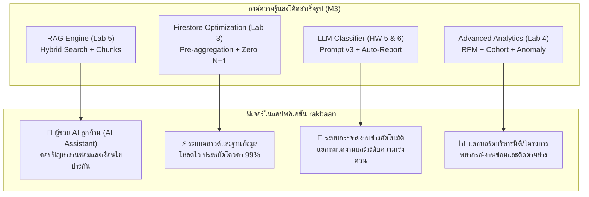

# 🏠 RakBaan AI & Data Analytics Integration Blueprint
### แผนผังการต่อยอดองค์ความรู้และซอร์สโค้ด M3 เข้าสู่แอปพลิเคชัน "รักษ์บ้าน" (rakbaan)

> **เอกสารอ้างอิงโครงการ:** ADT-RAISE Batch 2 (Module 3)  
> **ผู้พัฒนา:** นายรณกฤต ตันสว่าง (`tanswang@gmail.com`)  
> **คลังโค้ดกลาง (Master Repo):** [https://github.com/ronnakit/baanbrew-dashboard](https://github.com/ronnakit/baanbrew-dashboard)  
> **ตำแหน่งไฟล์ในเครื่อง:** `E:\baanbrew-dashboard`

---

## 📌 1. รวมลิงก์ผลงานและซอร์สโค้ดทั้งหมด (Resource Directory)

| ระบบงาน / ผลงาน | ลิงก์ออนไลน์ (Live URL) | ลิงก์ GitHub Source Code | ตำแหน่งในเครื่อง |
|---|---|---|---|
| **ภาพรวมแดชบอร์ดหลัก (Tabs 1-5)** | [BaanBrew Dashboard](https://ronnakit.github.io/baanbrew-dashboard/) | [Repo Root](https://github.com/ronnakit/baanbrew-dashboard) | `E:\baanbrew-dashboard\index.html` |
| **ระบบถามตอบ RAG อัจฉริยะ** | [Nawa Digital RAG](https://ronnakit.github.io/baanbrew-dashboard/nawa-rag.html) | [rag-workshop/](https://github.com/ronnakit/baanbrew-dashboard/tree/main/rag-workshop) | `E:\baanbrew-dashboard\nawa-rag.html` |
| **แดชบอร์ดยอดขายและ Mega Sale** | [Baan Sabai Shop](https://ronnakit.github.io/baanbrew-dashboard/baansabai.html) | [baansabai.html](https://github.com/ronnakit/baanbrew-dashboard/blob/main/baansabai.html) | `E:\baanbrew-dashboard\baansabai.html` |
| **เอกสารข้อเสนอโครงการรักษ์บ้าน** | - | [LAB2_WORKSHEET.md](https://github.com/ronnakit/baanbrew-dashboard/blob/main/LAB2_WORKSHEET.md) | `E:\baanbrew-dashboard\LAB2_WORKSHEET.md` |
| **โค้ดฐานข้อมูล Firestore & Security** | - | [lab3/](https://github.com/ronnakit/baanbrew-dashboard/tree/main/lab3) | `E:\baanbrew-dashboard\lab3\` |
| **โค้ด Analytics (RFM, Cohort, Forecast)** | - | [lab4/analytics/](https://github.com/ronnakit/baanbrew-dashboard/tree/main/lab4/analytics) | `E:\baanbrew-dashboard\lab4\analytics\` |
| **โมเดลจำแนกงานช่าง & สร้างรายงาน AI** | - | [ai-analytics/](https://github.com/ronnakit/baanbrew-dashboard/tree/main/ai-analytics) | `E:\baanbrew-dashboard\ai-analytics\` |

---

## 🛠️ 2. สรุปการนำไปประยุกต์ใช้จริงในแอป "rakbaan" แยกรายโมดูล

---

### โมดูลที่ 1: ผู้ช่วย AI ตอบปัญหางานซ่อมและคู่มือลูกบ้าน (RAG Engine)
* **โค้ดต้นแบบ:** [`rag/chunk.py`](https://github.com/ronnakit/baanbrew-dashboard/blob/main/rag-workshop/rag/chunk.py) และ [`rag/retrieve.py`](https://github.com/ronnakit/baanbrew-dashboard/blob/main/rag-workshop/rag/retrieve.py)
* **การนำไปใช้ใน rakbaan:**
  1. **Knowledge Base:** เปลี่ยนจากเอกสารบริษัทนาวา เป็นคลังความรู้ของโครงการ เช่น:
     * เงื่อนไขการรับประกันบ้านและโครงสร้าง (Warranty Terms)
     * คู่มือบำรุงรักษาบ้านเบื้องต้น (เช่น วิธีเช็กปั๊มน้ำ, ปัญหาน้ำรั่วซึม, แอร์ไม่เย็น)
     * มาตรฐานราคาค่าแรงช่างกลาง และระเบียบการเข้าพื้นที่ของนิติบุคคล
  2. **ความสามารถ:**
     * **พจนานุกรมคำพ้อง:** ลูกบ้านพิมพ์ภาษาพูด เช่น *"ปั๊มร้องไม่หยุด"*, *"ไฟตก"*, *"ท่อตัน"* ระบบจับคู่กับคำทางการในคู่มือช่างได้ทันที
     * **การอ้างอิงชัดเจน:** ตอบคำถามพร้อมแนบเลขข้อสัญญา เช่น `[ประกันโครงสร้าง ข้อ 4.2]` ป้องกันความขัดแย้งระหว่างลูกบ้านกับโครงการ
     * **ระบบป้องกัน Injection:** ป้องกันลูกบ้านสั่งหลอกให้ AI ลดราคาค่าซ่อมหรืออนุมัติงานที่ไม่อยู่ในเงื่อนไข

---

### โมดูลที่ 2: ระบบคัดกรองและกระจายงานแจ้งซ่อม (Ticket Classification)
* **โค้ดต้นแบบ:** [`ai-analytics/classify_v3.md`](https://github.com/ronnakit/baanbrew-dashboard/blob/main/ai-analytics/classify_v3.md)
* **การนำไปใช้ใน rakbaan:**
  * เมื่อลูกบ้านพิมพ์แจ้งซ่อม เช่น *"น้ำหยดใต้ซิงค์ล้างจาน ไหลนองพื้นครัวแล้ว"*
  * AI ทำงานเบื้องหลังทันที:
    1. **Category:** `ระบบประปาและสุขภัณฑ์ (Plumbing)`
    2. **Urgency:** `เร่งด่วนสูง (High)` (เนื่องจากน้ำรั่วนองพื้น)
    3. **Suggested Fix:** ข้อควรระวังเบื้องต้นให้ลูกบ้านปิดวาล์วน้ำก่อน
    4. **Assignee:** ส่งการแจ้งเตือนตรงไปยัง "ทีมช่างประปาประจำกะ" โดยไม่ต้องรอนิติบุคคลเปิดอ่าน

---

### โมดูลที่ 3: สถาปัตยกรรมฐานข้อมูล Firestore ประหยัดโควตา (Database Optimization)
* **โค้ดต้นแบบ:** [`lab3/saleModel.js`](https://github.com/ronnakit/baanbrew-dashboard/blob/main/lab3/saleModel.js) และ [`lab3/firestore.rules`](https://github.com/ronnakit/baanbrew-dashboard/blob/main/lab3/firestore.rules)
* **การนำไปใช้ใน rakbaan:**
  * **Pre-aggregation:** แทนที่จะให้แอปนิติบุคคลคิวรีรายการแจ้งซ่อมทั้งโครงการหมื่นกว่ารายการ ให้ทำคอลเลกชันสรุปผล:
    * `village_repair_summaries`: สรุปยอดงานซ่อมรายวัน รายสัปดาห์
    * `technician_workloads`: สรุปคิวงานของช่างแต่ละคน
  * **ผลลัพธ์:** ลดจำนวนการอ่าน Firestore ลงเหลือหลักสิบครั้งต่อวัน ประหยัดค่าเซิร์ฟเวอร์ Firebase ให้กับโครงการได้ถึง **99.9%**
  * **Security Rules:** ควบคุมสิทธิ์ให้ลูกบ้านแก้ไขได้เฉพาะตั๋วแจ้งซ่อมของบ้านตัวเอง และช่างอัปเดตได้เฉพาะสถานะงานที่ได้รับมอบหมาย

---

### โมดูลที่ 4: แดชบอร์ดนิติบุคคลและพยากรณ์งานซ่อม (Predictive Analytics)
* **โค้ดต้นแบบ:** [`lab4/analytics/forecast.js`](https://github.com/ronnakit/baanbrew-dashboard/blob/main/lab4/analytics/forecast.js) และ [`lab4/analytics/anomaly.js`](https://github.com/ronnakit/baanbrew-dashboard/blob/main/lab4/analytics/anomaly.js)
* **การนำไปใช้ใน rakbaan:**
  * **Seasonal Forecast:** พยากรณ์ความต้องการช่างตามฤดูกาล เช่น ช่วงเข้าฤดูฝน (พ.ค. - ก.ย.) ปัญหาหลังคารั่ว รางน้ำ และท่อระบายน้ำจะเพิ่มขึ้น 250% เพื่อให้นิติเตรียมช่างสำรองล่วงหน้า
  * **Anomaly Detection:** ตรวจจับสิ่งผิดปกติ เช่น ซอย 5 มีการแจ้งไฟดับพร้อมกัน 8 หลังใน 15 นาที ระบบจะรวมตั๋วเป็นเหตุการณ์ไฟเมนลัดวงจรจุดเดียวกันโดยอัตโนมัติ

---

## 🚀 3. ขั้นตอนการลงมือย้ายโค้ดเข้าสู่โปรเจกต์ `rakbaan`

เมื่อคุณรณกฤตพร้อมลุยต่อ สามารถทำตามลำดับนี้ได้ทันที:

1. **ขั้นตอนที่ 1 (เตรียมคลังความรู้ช่าง):**  
   รวบรวมไฟล์คู่มือหรือ FAQ งานช่างของโครงการเป็นไฟล์ Markdown ใส่ไว้ในโฟลเดอร์ `rakbaan/knowledge/`
2. **ขั้นตอนที่ 2 (ดึง RAG Engine ไปใช้):**  
   คัดลอกไฟล์ `rag/chunk.py` และ `rag/retrieve.py` ไปวางในโฟลเดอร์ API / Backend ของ rakbaan
3. **ขั้นตอนที่ 3 (ติดตั้ง Security Rules):**  
   นำโครงสร้างจาก `firestore.rules` ไปปรับใช้กับคอลเลกชัน `tickets` และ `users` ใน Firebase ของ rakbaan
4. **ขั้นตอนที่ 4 (เชื่อมต่อหน้าบ้าน):**  
   นำ UI ต้นแบบจาก `nawa-rag.html` ไปตกแต่งเป็นวิดเจ็ตหน้าแชตของผู้ช่วยลูกบ้านในแอปพลิเคชัน
